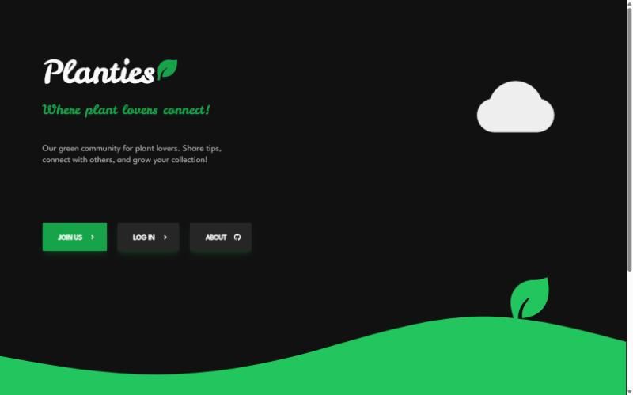
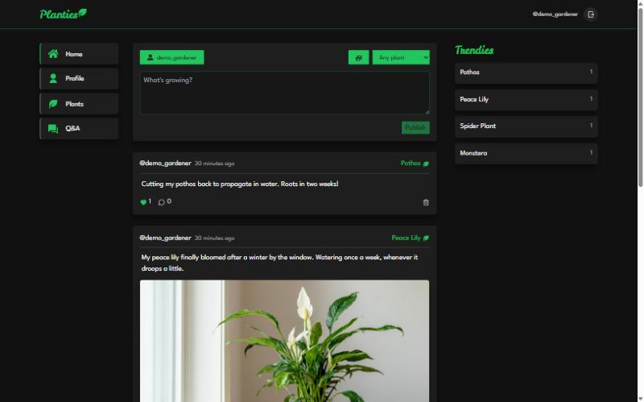
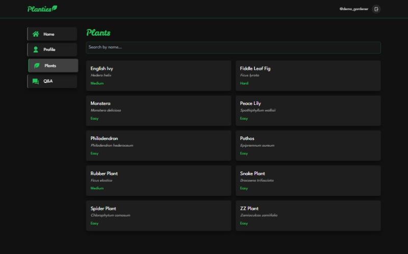
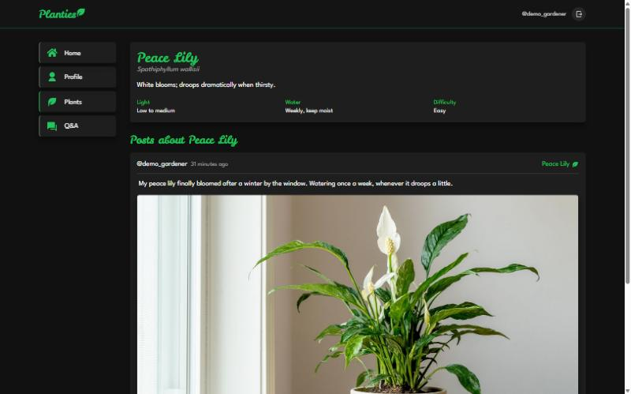

# Planties

A social network for plant lovers: share photos of your plants, discover species, and ask the community for help.

**Live demo:** https://planties.vercel.app

**Demo account** (no sign-up needed, use the "Try the demo account" button on the login form):

- Email: `demo@planties.app`
- Password: `Demo-QGX2kxRJ43`

## Features

- Email/password accounts: sign up, log in, log out, password reset by email
- Posts with image upload, optionally tagged with a plant species
- Likes and comments
- User profiles with their posts and an editable bio
- Plant species directory with search and per-species posts
- Q&A: ask questions, answer, and accept the best answer
- Trending plants, responsive layout, keyboard and screen-reader friendly forms

## Stack

React 18 · Vite · Tailwind CSS · React Router · Supabase (Auth, Postgres with row level security, Storage) · react-toastify

## Running locally

1. Create a free project at [supabase.com](https://supabase.com).
2. In the SQL editor run `supabase/schema.sql`, then `supabase/seed_species.sql`.
3. In Authentication > URL Configuration add `http://localhost:5173` (and your Vercel URL) as redirect URLs.
4. Copy the environment file and fill it from Project Settings > API:

```bash
cp .env.example .env
npm install
npm run dev
```

Optional, to create the demo account and sample content (the service role key is secret and is never used by the app itself):

```bash
SUPABASE_URL=... SUPABASE_SERVICE_ROLE_KEY=... DEMO_EMAIL=demo@example.com DEMO_PASSWORD=... node scripts/seed-demo.mjs
```

Set `VITE_DEMO_EMAIL` and `VITE_DEMO_PASSWORD` in `.env` to show the demo login button.

## Deploying

- Front-end: import the repo on Vercel and set `VITE_SUPABASE_URL`, `VITE_SUPABASE_PUBLISHABLE_KEY` (and the demo variables) as environment variables.
- Back-end: Supabase free tier, nothing else to host.

## Screenshots

| Landing | Feed |
|---|---|
|  |  |

| Species directory | Species page |
|---|---|
|  |  |
